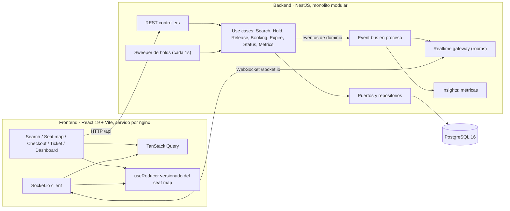

# Arquitectura

Documento de arquitectura del entregable. Explica las decisiones que sostienen la corrección
del sistema, no solo su estructura. El detalle de producción que queda fuera del alcance está en
[PLAN_APPENDIX.md §16](../PLAN_APPENDIX.md#16-production-path--out-of-scope).

## 1. Vista general



nginx sirve el bundle estático y hace proxy de `/api` y `/socket.io` al backend en la misma
origen. No hay CORS, las cookies de sesión viajan con `SameSite=Lax` y el upgrade de WebSocket se
resuelve en un único punto.

### Capas por módulo

```text
domain/          entidades, value objects, eventos e invariantes (TS puro)
application/     casos de uso, puertos (repositorios, clock, event bus, id generator)
infrastructure/  adaptadores: Postgres, Socket.io, controllers, fake payment
```

La regla se aplica con `eslint-plugin-boundaries` y con un test de arquitectura: `application` no
importa `infrastructure` ni las tripas de otro módulo; cada módulo expone solo su `index.ts`.

| Módulo          | Posee                                        | Habla con otros por                              |
| --------------- | -------------------------------------------- | ------------------------------------------------ |
| `catalog`       | vuelos, búsqueda, estado operativo           | `FlightStatePort` dentro de la misma transacción |
| `reservations`  | asientos, holds, bookings, sweeper           | eventos de dominio; pagos por puerto             |
| `payments`      | adaptador de pago fake                       | `PaymentPort`                                    |
| `insights`      | modelo de lectura de métricas                | consume eventos                                  |
| `realtime`      | gateway y mapeo de eventos                   | consume eventos; no persiste nada                |
| `notifications` | stub de notificaciones                       | consumiría eventos                               |
| `shared-kernel` | clock, ids, errores, event bus, Unit of Work | sin lógica de negocio                            |
| `testing`       | hook de reset para e2e                       | se registra solo con `NODE_ENV=test\|e2e`        |

`reservations` es el núcleo de consistencia: separar asientos de bookings obligaría a una saga.
Los demás módulos son extraíbles; el orden y los disparadores están en el apéndice.

## 2. Por qué este estilo

### 2.1 Monolito modular

El requisito difícil —no vender dos veces el mismo asiento— es un único límite transaccional.
Mantenerlo en un proceso y una transacción ACID es la solución correcta más simple. La
modularidad se paga con puertos, fronteras lintadas y tests, no con una red entre servicios.
La ruta de extracción existe (roles desplegables, módulos con dueños claros), pero no se ejecuta
en este entregable.

### 2.2 PostgreSQL como autoridad

Postgres aporta locks de fila, locks de asesoría transaccionales, `timestamptz`, `RETURNING`,
constraints y transacciones reales. La concurrencia se resuelve en SQL, no en memoria: dos
instancias del backend comparten el mismo lock y la misma verdad. Los tests de concurrencia
corren contra Postgres real, no contra mocks.

### 2.3 REST para mutaciones y Socket.io para push

Las mutaciones son REST porque son fáciles de testear, idempotentes y reintentables con
`fetch`/curl. Socket.io solo empuja eventos; el cliente nunca muta por WebSocket. Las rooms
(`flight:{id}` y `search`) permiten fan-out selectivo y el ack de `flight.join` cierra la ventana
de carrera entre la suscripción y el snapshot REST.

## 3. Modelo de datos y migraciones

El esquema vive en `public` y se crea desde SQL ordenado en
`backend/src/database/migrations/001_init.sql`:

- `flights` con `status ∈ {SCHEDULED, DELAYED, CANCELLED}`, `sold_out` derivado y `version`.
- `seats` con `status ∈ {AVAILABLE, HELD, BOOKED}`, `held_by_session`, `hold_expires_at`,
  `booking_id` y un `CHECK` que obliga a la forma correcta de cada estado.
- `bookings` con `code` único, `seat_id` único, `idempotency_key` único y `request_hash`.
- Índice parcial `seats_hold_expiry_idx ON seats (hold_expires_at) WHERE status = 'HELD'` para
  el sweeper.

```sql
CONSTRAINT seats_state_shape CHECK (
  (status = 'AVAILABLE' AND held_by_session IS NULL AND hold_expires_at IS NULL AND booking_id IS NULL)
  OR (status = 'HELD' AND held_by_session IS NOT NULL AND hold_expires_at IS NOT NULL AND booking_id IS NULL)
  OR (status = 'BOOKED' AND held_by_session IS NULL AND hold_expires_at IS NULL AND booking_id IS NOT NULL)
)
```

`bookings.seat_id UNIQUE` es la segunda línea de defensa: incluso un bug de lógica no puede
producir dos bookings para el mismo asiento. El `CHECK` mantiene la máquina de estados coherente
a nivel de base.

Las migraciones se aplican al arrancar bajo `pg_advisory_xact_lock(hashtext('migrations'))`, con
checksums y ledger `__migrations`; el seed es idempotente y usa UUIDv5 deterministas
(`flightNumber:label`), lo que permite a los tests referenciar asientos sin consultar ni depender
del orden de inserción. El seed solo corre en `development`, `staging`, `test` y `e2e`.

## 4. Concurrencia: cómo se evita el doble booking

Principio: **la base de datos decide, no la aplicación.**

### 4.1 Unit of Work y lock por vuelo

Todos los cambios de asientos o de estado de un vuelo pasan por
`PostgresUnitOfWork.runInFlightTransaction(flightId, work)`. Antes de cualquier mutación toma:

```sql
SELECT pg_advisory_xact_lock(hashtext($1)); -- $1 = 'flight:<uuid>'
```

El lock es transaccional (se libera en commit/rollback), vive en Postgres y serializa holds,
releases, booking, sweeper y cambios de estado **del mismo vuelo**. Vuelos distintos corren en
paralelo. El Unit of Work también fija `lock_timeout` y `statement_timeout`, reintenta errores
transitorios (`40001`, `40P01`, `55P03`) con backoff acotado y publica eventos solo después del
commit. Los casos de uso nunca toman locks, hacen commit ni emiten directamente.

### 4.2 Hold correcto en dos pasos

Con el lock por vuelo ya tomado, el caso de uso rechaza un vuelo `CANCELLED` y ejecuta:

```sql
UPDATE seats
SET status = 'HELD',
    held_by_session = $3,
    hold_expires_at = now() + make_interval(secs => $4),
    version = version + 1
WHERE id = $1
  AND flight_id = $2
  AND (status = 'AVAILABLE'
       OR (status = 'HELD' AND hold_expires_at <= now()))    -- lazy expiry
  AND EXISTS (
    SELECT 1
    FROM flights f
    WHERE f.id = $2
      AND f.status IN ('SCHEDULED', 'DELAYED')
  )
RETURNING id, label, hold_expires_at;
```

Una fila significa éxito. Cero filas lleva al segundo paso: comprobar si el hold ya es mío y
sigue vigente.

```sql
SELECT s.id, s.label, s.hold_expires_at, f.version AS flight_version
FROM seats s
JOIN flights f ON f.id = s.flight_id
WHERE s.id = $1
  AND s.flight_id = $2
  AND s.status = 'HELD'
  AND s.held_by_session = $3
  AND s.hold_expires_at > now();
```

Si hay fila, se responde `200` con el mismo `expiresAt` y **sin extender el TTL, sin evento y sin
subir versión**. Si no hay fila, `409 SEAT_UNAVAILABLE`.

El `UPDATE` condicional bajo row locks es atómico: dos sesiones que compiten por el mismo asiento
solo pueden obtener una fila. El lock por vuelo hace además que el conteo de holds y el recomputo
de `sold_out` no compitan con otras mutaciones del vuelo.

### 4.3 Máximo de 4 holds por sesión y vuelo

Después de la comprobación idempotente y antes del `UPDATE`:

```sql
SELECT count(*)::int AS count
FROM seats
WHERE flight_id = $1
  AND status = 'HELD'
  AND held_by_session = $2
  AND hold_expires_at > now();
```

Si el conteo es `>= 4`, `409 HOLD_LIMIT`. La comprobación idempotente va primero: un re-click
sobre un hold propio sigue devolviendo `200` incluso en el límite. Todo el bloque está serializado
por el lock por vuelo, así que el resultado es determinista.

### 4.4 Release

```sql
UPDATE seats
SET status = 'AVAILABLE',
    held_by_session = NULL,
    hold_expires_at = NULL,
    version = version + 1
WHERE id = $1
  AND flight_id = $2
  AND status = 'HELD'
  AND held_by_session = $3
RETURNING id, label;
```

Solo el dueño puede liberar. Si no hay fila, `409 SEAT_UNAVAILABLE`. El release se permite aunque
el vuelo esté cancelado; el usuario puede devolver el asiento.

### 4.5 Confirmación de booking

Secuencia real de `ConfirmBooking`:

1. Fuera de la transacción, buscar por `idempotency_key`: si existe y el hash coincide, devolver
   el booking original (`200`); si el hash difiere, `409 IDEMPOTENCY_CONFLICT`.
2. Abrir la transacción del vuelo (advisory lock) y repetir la búsqueda dentro de ella.
3. Bloquear la fila del asiento con `FOR UPDATE OF s` y verificar que pertenece al vuelo.
4. Rechazar vuelo `CANCELLED` con `409 FLIGHT_NOT_BOOKABLE`.
5. Verificar propiedad y vigencia del hold. Si otro lo posee, `409 SEAT_UNAVAILABLE`; si expiró,
   re-chequear la idempotencia y responder replay o `410 HOLD_EXPIRED`.
6. Ejecutar el pago fake (`TEST_OK`/`TEST_DECLINE`) con `PAYMENT_DELAY_MS`.
7. Insertar el booking con un `SAVEPOINT` por intento de código (máximo 3), y actualizar el
   asiento con una condición final de vigencia:

```sql
UPDATE seats
SET status = 'BOOKED',
    held_by_session = NULL,
    hold_expires_at = NULL,
    booking_id = $3,
    version = version + 1
WHERE id = $1
  AND flight_id = $2
  AND status = 'HELD'
  AND held_by_session = $4
  AND hold_expires_at > now()
RETURNING id;
```

Si el `UPDATE` no devuelve fila, el hold expiró durante el pago: se responde `410 HOLD_EXPIRED`
con `{refunded:true}` y se hace rollback del booking. Los `UNIQUE` de `idempotency_key`,
`bookings.seat_id` y `bookings.code` arbitran carreras concurrentes; el caso de uso relee el
ganador para devolver un replay consistente.

### 4.6 Sweeper y expiración lazy

El sweeper corre cada segundo y no solapa ticks. Su transacción usa un lock de elección:

```sql
SELECT pg_try_advisory_xact_lock(hashtext($1)) AS locked; -- $1 = 'sweeper'
```

Si no es elegido, no hace nada. Si lo es, lista vuelos con holds vencidos, toma el lock de cada
vuelo y libera:

```sql
UPDATE seats
SET status = 'AVAILABLE',
    held_by_session = NULL,
    hold_expires_at = NULL,
    version = version + 1
WHERE flight_id = $1
  AND status = 'HELD'
  AND hold_expires_at <= now()
RETURNING id, label;
```

La expiración lazy dentro del `UPDATE` de hold garantiza que un hold vencido pueda tomarse aunque
el sweeper esté caído; el sweeper solo se encarga de devolver el asiento al mapa y emitir el
evento. Todos los eventos se publican después del commit.

### 4.7 Versiones y eventos after-commit

`flights.version` es una secuencia monótona. Cada evento de cambio de estado consume una versión:
`FlightStatePort.recordSeatChange(tx, flightId, seatEvents)` calcula
`eventCount = seatEvents + (soldOutToggled ? 1 : 0)`, asigna versiones consecutivas a los eventos
de asiento y deja `flight.updated` con la última. `flight.metrics` es derivado y lleva la última
versión sin consumir una nueva.

El `PostCommitEventPublisher` recolecta eventos en `AsyncLocalStorage`; el Unit of Work los
descarga **solo después del COMMIT**. Un rollback no emite nada. `RealtimeEventPublisher` los
mapea a rooms y programa `flight.metrics` con deduplicación por vuelo y ventana
`METRICS_BATCH_MS`.

## 5. Tiempo real

### 5.1 Protocolo de sincronización

1. `SocketProvider` hace `fetch('/api/health')` para obtener la cookie de sesión firmada y recién
   después abre `io({ path: '/socket.io' })`.
2. Al conectar, el cliente emite `flight.join` y **espera el ack** antes de pedir el snapshot.
3. Los eventos que llegan durante la espera se guardan en un buffer.
4. Llega el snapshot REST con `version` y `serverTime`; el reducer descarta eventos con versión
   menor o igual y drena el resto ordenado por versión.
5. En vivo, cada evento con versión mayor se aplica una vez; duplicados y eventos viejos se
   ignoran. `holdSucceeded`/`releaseSucceeded` actualizan el estado local sin avanzar la versión:
   la verdad de la versión la fija el evento del servidor.

El snapshot solo conserva el asiento seleccionado si sigue `AVAILABLE` o `HELD` con `isMine`; si
mientras tanto se vendió o expiró, se limpia la selección y se refresca.

### 5.2 Rooms y eventos

- `flight:{id}`: `flight.updated`, `seat.held`, `seat.released`, `seat.booked`, `flight.metrics`.
- `search`: `flight.updated` para que la lista de resultados se parchee sin recargar.
- `flight.join`, `flight.leave` y `search.join` devuelven ack; las mutaciones siguen siendo REST.

### 5.3 Reconnect

Al reconectar se vuelve a `buffering`, se re-emite `flight.join` y se pide un snapshot nuevo. Los
eventos recibidos mientras se resuelve el snapshot se drenan por versión. El contador de
ocupación y el feed de actividad se recuperan del snapshot/métricas; la UI no depende de haber
visto todos los eventos históricos.

## 6. Estados de vuelo y cancelación

`status` es operativo; `sold_out` es derivado de la disponibilidad. Son independientes a propósito:
un cambio de disponibilidad nunca pisa una decisión operativa.

| Desde       | Hacia                    | Regla                                   |
| ----------- | ------------------------ | --------------------------------------- |
| `SCHEDULED` | `DELAYED`, `CANCELLED`   | permitido                               |
| `DELAYED`   | `SCHEDULED`, `CANCELLED` | permitido; `SCHEDULED` vuelve `delay=0` |
| `CANCELLED` | —                        | terminal; cualquier transición es `409` |

Cancelar bloquea holds y bookings nuevos (`FLIGHT_NOT_BOOKABLE`), pero **no libera los holds
existentes**: expiran por TTL y no pueden confirmarse. El release del dueño sí se permite. Las
reservas ya confirmadas permanecen; no hay reembolso en este alcance. El endpoint de
administración está abierto en la demo y debe protegerse en producción.

## 7. Contrato de booking e idempotencia

```json
{
  "flightId": "uuid",
  "seatId": "uuid",
  "passenger": { "name": "Ada Lovelace", "email": "ada@example.com" },
  "payment": { "method": "TEST_OK" }
}
```

`Idempotency-Key` es un UUID obligatorio. El servidor calcula un SHA-256 canónico con orden fijo
de campos, nombre recortado y email en minúsculas; nunca hashea el body crudo, headers ni
timestamps. La primera confirmación devuelve `201`; un replay con el mismo hash devuelve `200` con
el mismo código. Un mismo key con payload distinto devuelve `409 IDEMPOTENCY_CONFLICT`.

No se reciben datos de tarjeta: `payment.method` es un token. Un decline (`TEST_DECLINE`) deja el
hold intacto y no crea fila en `bookings`.

| HTTP | Código                      | Cuándo                                                    |
| ---- | --------------------------- | --------------------------------------------------------- |
| 400  | `VALIDATION_ERROR`          | body/header inválido, key ausente o no UUID               |
| 402  | `PAYMENT_DECLINED`          | `TEST_DECLINE`                                            |
| 404  | `BOOKING_NOT_FOUND`         | lookup con código o email incorrectos (misma respuesta)   |
| 409  | `SEAT_UNAVAILABLE`          | asiento de otro vuelo, hold ajeno o ya vendido            |
| 409  | `HOLD_LIMIT`                | quinto hold activo de la sesión en el vuelo               |
| 409  | `IDEMPOTENCY_CONFLICT`      | mismo key con otro payload                                |
| 409  | `FLIGHT_NOT_BOOKABLE`       | vuelo cancelado                                           |
| 409  | `INVALID_STATUS_TRANSITION` | transición administrativa inválida                        |
| 410  | `HOLD_EXPIRED`              | hold vencido; `{refunded:true}` si venció durante el pago |
| 429  | `RATE_LIMITED`              | límite global o dedicado                                  |
| 500  | `INTERNAL_ERROR`            | error no clasificado, sin stack ni SQL en la respuesta    |

## 8. Testing

- **Unitarios (23):** reducer versionado, reconnect buffer, countdown, idempotencia —incluido el
  fallback de UUID fuera de contexto seguro—, hash, guards, Unit of Work, redacción de logs y
  fronteras de arquitectura.
- **Integración (41):** Vitest serial contra PostgreSQL real en la base `app_test`, con migraciones,
  seed determinista y reset entre archivos. Cubren concurrencia de 50 sesiones, idempotencia,
  límite de holds, sweeper, carreras de booking/cancelación, rate limit dedicado, cookie/trust
  proxy, sockets reales y el hook de reset de e2e.
- **E2E (5):** Playwright con `workers: 1`, contextos aislados por usuario y un vuelo por test. El
  perfil `e2e` usa TTL de 5s y `PAYMENT_DELAY_MS=50`; cada test hace `POST /api/test/reset` con el
  token del perfil. Cubren hold cruzado, booking + ticket, cambio de estado administrativo,
  expiración con dashboard y axe WCAG 2.1 AA. El bug de `crypto.randomUUID` en un origen HTTP no
  seguro lo detectó esta suite, no una revisión manual.

## 9. Decisiones técnicas

| Decisión                                         | Por qué                                                                                                                                                  |
| ------------------------------------------------ | -------------------------------------------------------------------------------------------------------------------------------------------------------- |
| Drizzle + SQL explícito                          | Tipado del esquema, pero las sentencias críticas quedan visibles y revisables.                                                                           |
| `now()` de Postgres como única fuente de TTL     | Sobrevive reinicios, no depende del reloj del proceso ni del navegador. El `Clock` de dominio solo marca timestamps de eventos.                          |
| Cookie `sid` firmada, `HttpOnly`, `SameSite=Lax` | Sin login en el challenge, pero con identidad no legible por JS; `trust proxy` detrás de nginx.                                                          |
| Zod + `@flight/shared` con tsup dual ESM/CJS     | Un solo contrato para Nest (CJS) y Vite (ESM), sin DTOs duplicados.                                                                                      |
| Esquema `public` + ledger de migraciones         | Simplicidad de un día sin perder trazabilidad; los schemas por módulo son la ruta de extracción.                                                         |
| Admin abierto                                    | La demo no tiene autenticación de back-office; se documenta como límite y se protegería en producción.                                                   |
| Podman rootless + imágenes fijadas               | El evaluador no instala Node, Postgres ni navegadores; no hay daemon.                                                                                    |
| Zustand no se usa                                | El seat map necesita una máquina de estados versionada y pura; `useReducer` la expresa mejor que un store global. La dependencia se retiró en la fase 5. |

## 10. Principios y patrones

- **DRY:** contratos solo en `shared/`; SQL crítico explícito en adaptadores; versionado y
  `sold_out` centralizados en `FlightStatePort`; un único reducer para el estado vivo del seat
  map; seeds y builders compartidos en tests.
- **SRP:** un caso de uso por operación (`AcquireHold`, `ReleaseHold`, `ConfirmBooking`,
  `ExpireHolds`, `SearchFlights`, `ChangeFlightStatus`, `GetMetrics`); controllers y gateway
  delegan.
- **OCP/LSP:** adaptadores detrás de puertos; fake payment y un futuro proveedor comparten el
  shape de resultado/error.
- **ISP:** puertos estrechos (`UnitOfWork`, `SeatRepository`, `BookingRepository`,
  `FlightQueryPort`, `FlightStatePort`, `PaymentPort`, `EventPublisher`, `Clock`, `IdGenerator`);
  no hay repositorio genérico.
- **DIP:** `application` importa solo puertos y dominio; Nest cablea en el composition root.

Patrones usados: Ports & Adapters, Unit of Work, Repository, Domain Events after-commit,
transition guards, Strategy para pagos y batching de métricas. Deliberadamente **no** se usan
Saga, Event Sourcing, Outbox ni repositorios genéricos: el alcance es un monólito transaccional y
esas piezas agregarían complejidad sin resolver el requisito.

## 11. Límites y camino a producción

El entregable no incluye AWS, Terraform, Helm, CD, tracing, outbox, máquina de estados de pagos
reales ni jobs asíncronos. Están identificados y justificados en
[PLAN_APPENDIX.md §16](../PLAN_APPENDIX.md#16-production-path--out-of-scope).

### Tabla de modos de fallo

| Fallo                      | Efecto actual                                             | Mitigación en el entregable               | Cambio de producción                           |
| -------------------------- | --------------------------------------------------------- | ----------------------------------------- | ---------------------------------------------- |
| Postgres caído             | `/api/health` falla; requests con error                   | healthcheck y dependencia de compose      | RDS Multi-AZ, failover, reintentos de conexión |
| Reinicio del backend       | Holds y bookings sobreviven en la DB                      | estado en Postgres; reconexión + snapshot | apagado ordenado y readiness                   |
| Sweeper detenido           | Asientos vencidos quedan `HELD`                           | expiración lazy al intentar tomarlos      | alerta de lag y job con lock                   |
| Pago lento                 | El lock del vuelo se retiene durante el pago              | delay fake acotado (50–300ms)             | pago fuera de la transacción + gracia corta    |
| Pérdida de socket          | La UI queda desactualizada                                | buffer + snapshot + versiones             | adapter de Socket.io y fan-out distribuido     |
| Redis caído                | No aplica: no se usa                                      | —                                         | adapter de Socket.io y plan de degradación     |
| Reloj desfasado            | El countdown del navegador se corrige con `serverTime`    | TTL con `now()` de la DB                  | NTP y monitoreo de skew                        |
| Evento perdido tras commit | La UI se cura al reconectar; no hay side effects externos | snapshot al reconectar                    | outbox + relay para emails/recibos             |
| Vuelo cancelado con holds  | Los holds duran hasta el TTL y no se pueden booking       | guards de hold y booking                  | política de cancelación/reembolso explícita    |

### Limitaciones conocidas del entregable

- Sesión anónima, sin autenticación real.
- Pago simulado por token; no hay PAN ni integración con proveedor.
- Una sola instancia de backend en compose; Socket.io no usa adapter.
- Endpoint administrativo abierto en la demo.
- Sin tracing, métricas Prometheus, outbox ni jobs asíncronos.
- Los holds de un vuelo cancelado permanecen hasta su TTL (no se liberan al cancelar).
- El override de desarrollo requiere `--in-pod=false` por la combinación de pod por defecto y
  `userns_mode: keep-id`; el arranque y el proxy de Vite están validados.
